# How each part starts, stops, and recovers

This is the order things happen in when each part starts, fails, retries, and
shuts down. A tidy-up can move this code into smaller files, but must not change
the order, wait times, who owns what, or the states that get reported.

What users and other programs see is in [Behavior that must stay the
same](behavior-contract.md). Clock math is in [How time and coordinates
work](time-and-coordinate-semantics.md).

## Vicon bridge

`BridgeState` is `Disconnected`, `Connecting`, `Streaming`, or `Stopped`.

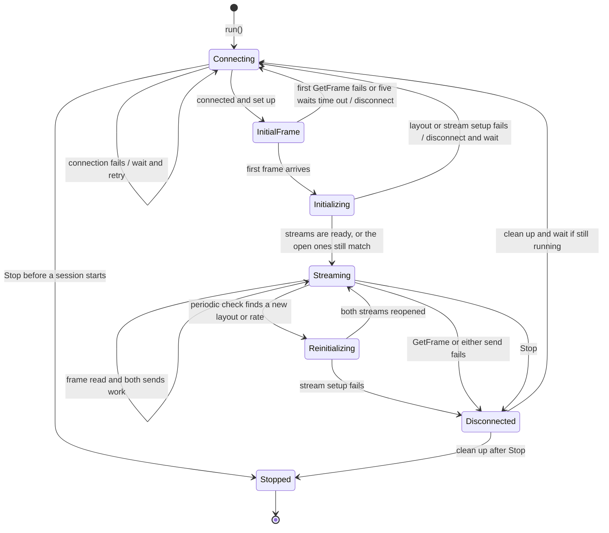

### Connect

1. `run()` makes one timestamp record before the reconnect loop, and keeps it
   across reconnects so time never goes backward.
2. Report `Connecting`, then try. After a failure, report the wait, then wait in
   steps of at most 100 ms so Stop takes effect fast.
3. Once connected, set a 256-frame SDK buffer, use `ServerPush`, and turn on
   marker and segment data. If any of that fails, disconnect and count it as a
   failed connection.
4. Wait 200 ms, then keep only the newest frame the SDK holds. Vicon first sends
   a new client frames left from the last client, which can be minutes old.
5. Stop while connecting or waiting closes any connection and reports `Stopped`.

### First frame and opening streams

1. Read one frame before reading names or opening streams. Allow the same five
   one-second waits as streaming, because Vicon sends nothing while it's paused
   or between frames of a slow replay.
2. If that first read fails, or all five waits time out, disconnect. Retry right away the first time, since a
   server that's still starting usually answers next time. After that, wait the
   normal interval, so a server that never sends frames can't cause a retry
   loop. A good first frame resets this.
3. Read the layout in Vicon's order. Stop at the first count or name that fails,
   and throw the half-read layout away. Never publish half a layout.
4. Only clear errors from an earlier session once the layout has been read.
5. If both streams are still open from before a reconnect, and the layout and
   rate match them, keep them. Otherwise close any open ones, then open the
   marker stream, then the segment stream. If either fails, close both. An empty
   layout is fine and opens no stream.

### Send frames

Each time round:

1. Read a frame. If none came within the SDK's one-second wait, keep the streams,
   log `No Vicon frame arrived in time; waiting` once, and log `Vicon frames
   resumed` when they come back. Five waits in a row, or any other failed read,
   ends the session.
2. Pick a finite timestamp later than the last one (see [How time and
   coordinates work](time-and-coordinate-semantics.md)). If there isn't one, skip
   the frame. Report when the frame clock restarts or time steps back, and log
   the first small nudge and every 100th after it.
3. Read every known marker and segment. A hidden or failed item sends a fixed-size
   "missing" value and doesn't end the session.
4. Send markers, then segments, with the same timestamp. If either send fails,
   report that streams will be reopened and end the session.
5. Every 100 frames, or every second if that comes first, report status and read
   the layout again. The window counts a bridge silent for three seconds as
   stale, and 100 frames take longer than that below about 33 Hz.

### Layout check

- If reading the layout fails, report the error but keep the current streams,
  and don't say the layout changed.
- If the layout and frame rate are the same (a rate within 1% counts as the
  same), keep going.
- If either changed, close both streams, then open new ones. Only a layout change
  is counted, because a rate change keeps the channels and the recorder rejoins
  the new streams. A layout that differs after a reconnect counts too.
- If opening the new streams fails, clean up fully.

### Errors and status

- Errors keep the frame number, subject, object, action, SDK result, and message
  all the way to the log.
- Errors are grouped by action, subject, object, SDK result, and message. The
  first copy is logged, then every 100th repeat with a count.
- Reads count as recovered only after 100 clean frames in a row, which logs
  `Vicon reads recovered`. So a marker hidden every other frame is logged like
  any repeating error.
- `BridgeStatus` holds the state, marker and segment counts, frame number, layout
  change count, and a message.

### Clean up

In this order: close the marker stream and the segment stream if Stop was asked
for, disconnect, reset the frame count, layout, and errors, report
`Disconnected`. Then wait and reconnect, or report `Stopped` if Stop was asked
for.

A reconnect keeps the streams open. Closing a stream that LabRecorder is
reading makes liblsl send it one last sample with old values and a current time,
and LabRecorder takes seconds to find a reopened stream. While Vicon is away the
streams stay visible but send nothing. They close when Stop is asked for, when a
send fails, or when the layout or rate changes.

With LabRecorder reading, liblsl took 1 to 7 s to close a stream in testing. So
the command-line and desktop apps make a `BackgroundOutletCloser` first thing in
`main()`, and streams close on its thread instead:

- The bridge keeps reading Vicon while a replaced stream closes, and Stop
  returns at once.
- A new stream with the same source ID can appear before the old one has
  finished closing. The old one stops answering stream searches when its close
  starts, and LabRecorder only rejoins a stream with a new ID.
- Before the program exits, the closer waits up to 10 s for the last closes.

Without a closer, as in the tests, a stream closes where the bridge lets it go.

`stop()` only flips a flag, and nothing flips it back. The desktop app makes a
new bridge after every Stop.

## Desktop window and bridge worker

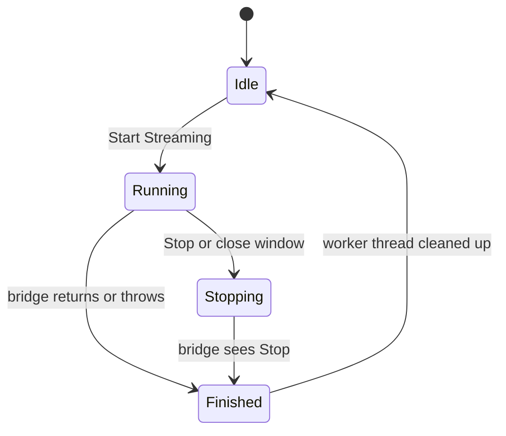

- Start creates one `BridgeWorker` and starts it. The worker sets the status
  callback inside its own `run()`.
- Stop disables the Stop button and asks the bridge to stop. It doesn't delete
  the worker.
- When the worker finishes, the controls come back, the worker is deleted later,
  and a waiting window close can go ahead.
- The shown rate is the change in frame number over the time between status
  messages.

## LabRecorder connection

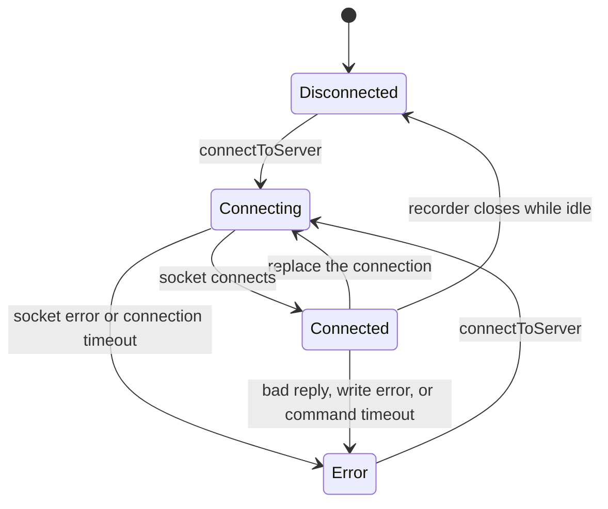

A new connection is refused while a command group is running, or while the open
connection is recording or may have sent a Start. A lost connection can always be
replaced. Replacing one stops both timers, drops unsent data and partial
replies, closes the old socket, and sets the recording state to `Unknown`. The
connection and command timeouts are separate.

The recording state is `Unknown`, `Recording`, or `Stopped`, and only changes
when this app gets a good reply to Start or Stop. A failure sets it back to
`Unknown`. The app also tracks what it's doing right now: `Idle`, `Refreshing`,
`UpdatingFilename`, `Starting`, `Stopping`, or `ShuttingDown`.

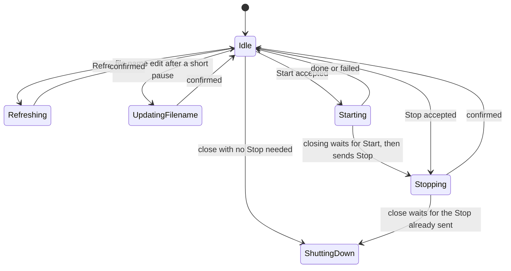

### Command groups

- One group at a time, and one command waiting for a reply at a time.
- Keep any part of a command not sent yet, and keep partial replies until `OK`
  can be checked. Skip spaces, tabs, and line breaks before it. `OK` is enough,
  so don't wait for the rest of the line.
- A timeout, bad reply, write error, or disconnect fails the group and closes the
  connection. A bad reply is logged with at most its first 80 bytes.
- A second Start or Stop, a refresh, or a file name change is refused while a
  group runs. So double clicks send one command.
- A Stop asked for during Start or another command is kept and sent once the
  recorder is idle. If the connection was lost, it's kept until **Connect**
  brings it back. Meanwhile the Stop button is off and the display shows
  Stopping.
- Reconnecting after a lost connection remembers that a Start may have reached
  the recorder, until Stop is confirmed.

### Starting a recorder here

1. Check the recorder address first. If something answers, use it.
2. Only start one if automatic start is on and nothing answers.
3. Run it from its own folder without freezing the window. Its state is
   `External`, `Launching`, `OwnedRunning`, `OwnedExited`, `LaunchFailed`, or
   `Detached`, shown as words like **External** and **Started here**.
4. Send its output to the event log, at most 64 KiB in all and 4 KiB per line.
5. Try to connect every 250 ms, while not connected or connecting, for up to 15
   seconds.
6. **Disconnect** never closes a recorder someone else started. **Detach** leaves
   one started here running and stops the app closing it later.

In exact-stream mode, the app starts `LabRecorderCLI` the same way, with the
output path and one search per stream. Stop sends it Enter. The app never mixes
this up with a LabRecorder window someone else started.

## Closing the window

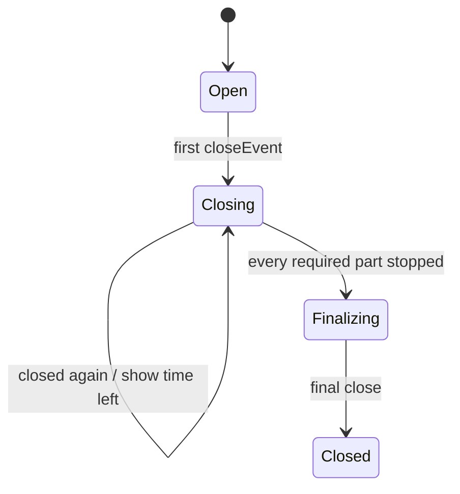

On the first close:

- Enter Closing once and ignore later close requests.
- Refuse new Start, stream search, file name, and session work.
- Tell the recorder to shut down once. If Start hasn't reached `start` yet, it's
  cancelled. Otherwise one final Stop is sent after it. A Stop already sent is
  never sent again. Closing doesn't start a file check.
- Ask the preview and bridge to stop, cancel file and stream work, and keep the
  window responsive.
- Every 50 ms, update which part is still running and how long it's taken.

The limits shown are four seconds for the bridge, two for the preview and file
work, and 15 for the recorder. Only the recorder limit does anything: after it,
a recorder this app started is closed, and forced a second later. A recorder
someone else started is never closed. If its connection was already lost, it's
marked done straight away as `Recorder connection lost`. The other limits are
only shown. A Vicon call that can't be cancelled may run past four seconds, and
the window shows that until it returns.

Normal window work should finish within 50 ms. Stop only sets a flag. Clean-up
for Vicon, LSL, files, and processes happens off the window thread, and a running
worker is never deleted.

## Preview

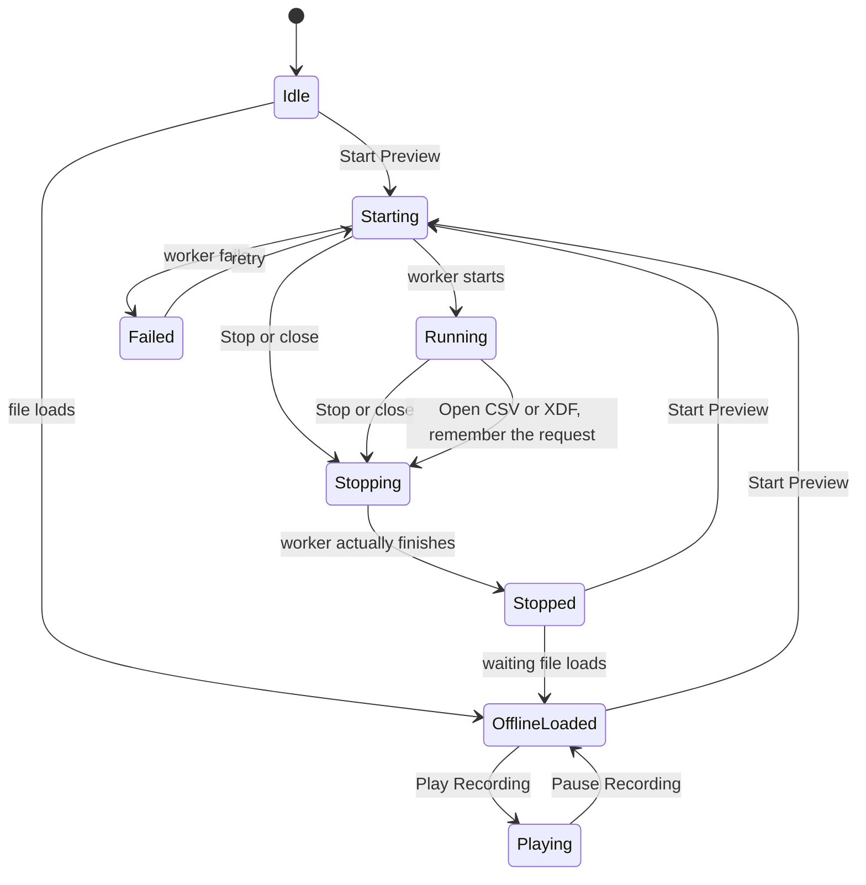

- Starting the live preview stops playback, clears trails, and starts a worker.
- Stop only sets a flag. The panel stays in Stopping, with restart and file open
  off, until the worker has really ended.
- Opening a file while live remembers it, stops the worker, and loads the file
  once the worker is done.

### One live stream

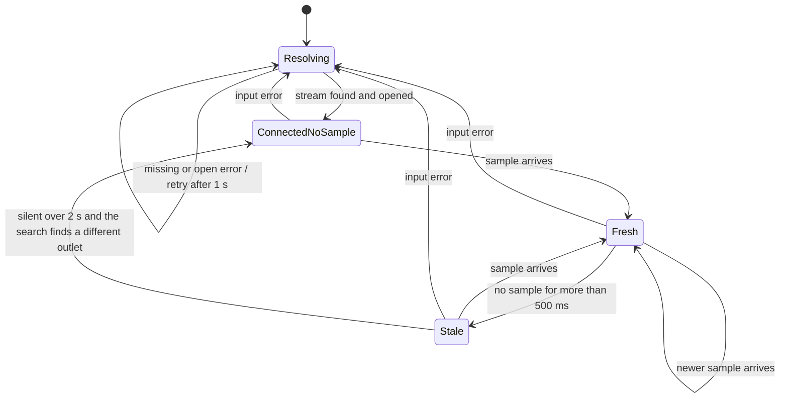

Connected and having recent data aren't the same thing. `*_stream_present` only
means the input is connected.

Searches wait at most 50 ms, detail reads at most 250 ms, and sample reads never
wait. A missing stream is looked for once a second. So is a connected stream
that's been silent for two seconds: if the search finds a different outlet, the
preview opens it. This matters because liblsl only rejoins a replacement with the
same channel count, and the bridge changes the channel count when Vicon subjects
change. If it finds the same outlet, the preview keeps waiting.

### Loading a recording

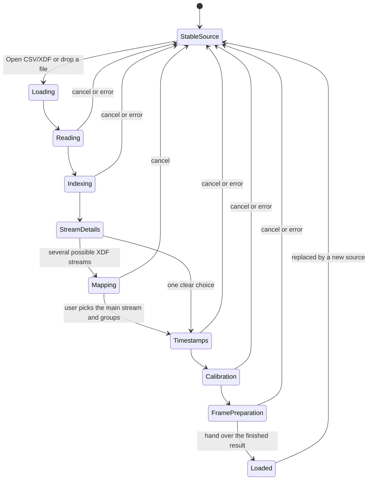

The worker checks for cancel at least every 1,024 steps and reports progress at
each stage. Cancelling also ends a wait for the user to pick streams. A failure
or cancel keeps what was on screen and never hands over half a recording.

### Stair alignment

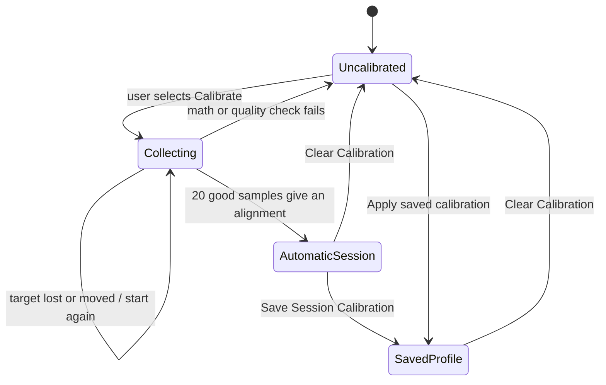

On screen, `SavedProfile` is **Saved calibration** and `Uncalibrated` is **Not
calibrated**.

- Losing the target clears the collected positions. A position that moved too far
  starts collecting again from there.
- If coordinate details are missing or don't match, collecting waits until the
  user confirms.
- An automatic alignment only lasts for this app session unless it's saved.
- Alignment changes reach the worker through a lock, and the view refits.
- Progress updates go out at most every 100 ms, so the target stream can't flood
  the window.

## A recording session

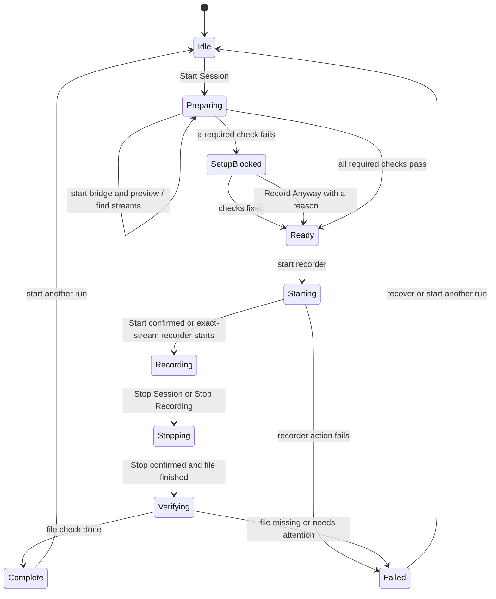

**Start Session** starts the bridge, the preview, the stream search, the setup
check, and the recorder, in that order. **Stop Session** goes the other way:
stop the recorder, wait for the file check, then stop the preview and bridge.
Every step can also be done by hand, and you can see which steps finished.
Cancelling and retrying Start runs a fresh stream search.

A Vicon layout change during a recording is logged as an error, because the
recorder can't follow the new streams. Stop and start a new recording.

## File check

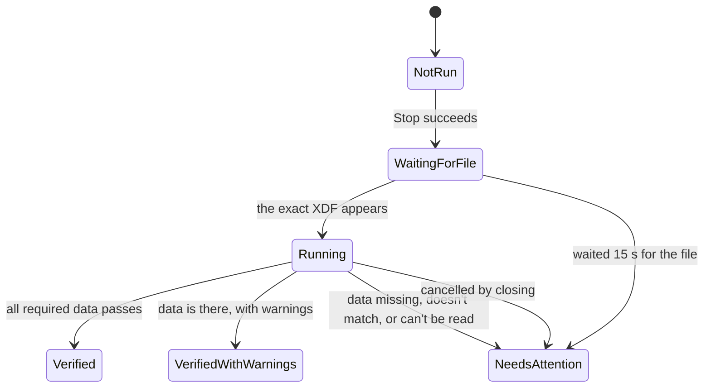

On screen, `Verified` is **Checked** and `VerifiedWithWarnings` is **Checked
with warnings**.

## HoloLens tracker

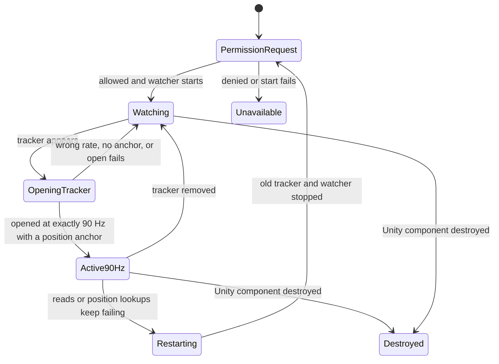

Counters keep old work out of a new session:

- `watcherGeneration` ignores a late reply from an older watcher.
- `trackerLifecycleGeneration` ignores a late `OpenAsync` reply after the tracker
  was removed or restarted.
- `sessionGeneration` tags each reading and tells the LSL output when the session
  changed.
- Starting, removing, or restarting a tracker resets the reading-time check,
  empties both queues, and clears the lookup failure count.

### One gaze sample

1. `TryGetNextSample` works forward from the last accepted capture time, up to 32
   readings per step, while holding the tracker lock. It waits until one frame
   plus the delivery delay has passed, and stops once it has the newest reading.
   With no last capture time yet, or while catching up is paused, it asks for the
   reading at the current time instead.
2. Refuse a missing, repeated, earlier, or broken capture time. A reading fetched
   for the current time must be within 50 ms either way.
3. A failed read inside the SDK doesn't hold back samples already waiting. They're
   sent first, and the failure is reported once the queue is empty. After three of
   the SDK's broken "nothing newer" results, stop catching up for ten seconds.
4. Copy the combined ray, and each eye's ray if there is one.
5. Add it to the raw queue, which holds at most 500 ms and 360 items.
6. Unity's `Update` converts at most 32 readings, each using where the headset was
   at that reading's capture time, and adds them to the converted queue.
7. Before sending, if the converted queue is over its limit, keep only the newest
   item. Then send the oldest.

If the headset position lookup just fails, still send a sample at the capture
time with invalid rays. If it keeps throwing, restart the tracker. Never make up a
capture time.

## HoloLens LSL output

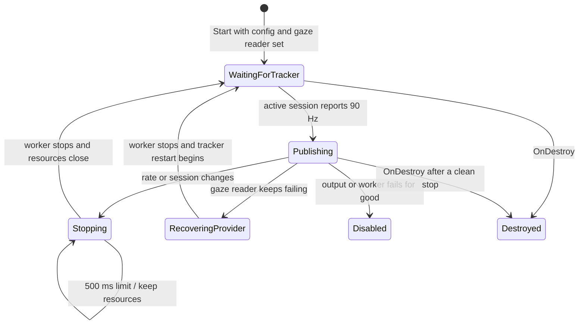

- Never close or replace the stream while the old worker might still send to it.
  If the worker doesn't stop within 500 ms, keep both and try again later.
- Short gaze reader errors don't restart the tracker. About one second of errors
  in a row does.
- Drop samples with bad times but keep to the schedule.
- An error from the LSL output stops the worker for good.
- A reopened stream keeps its name, type, and source ID.

The stair target output is simpler. It opens one stream and sends every
`LateUpdate`. An error while opening or sending turns it off and closes the
stream.
